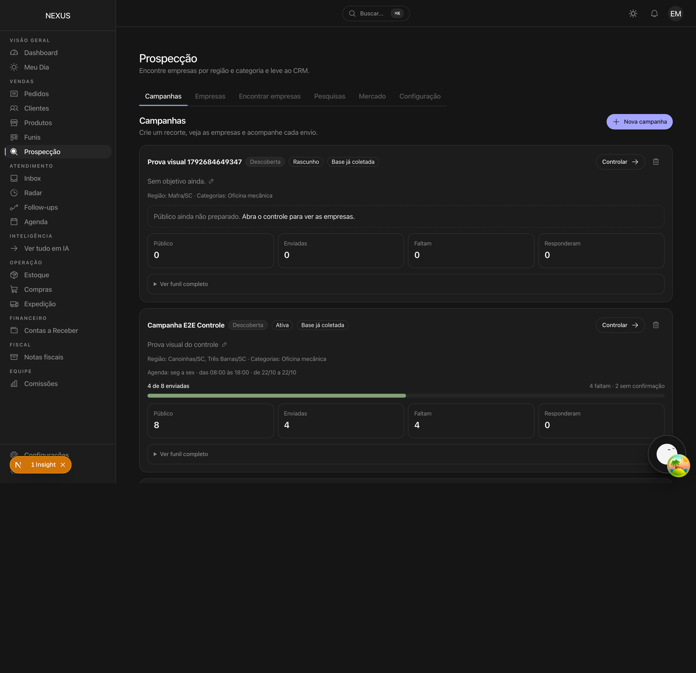
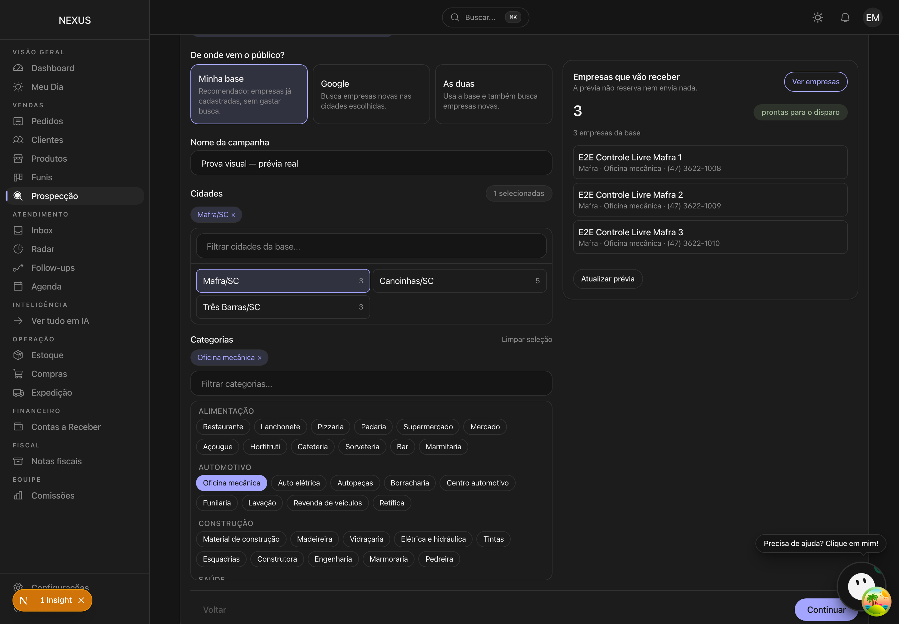
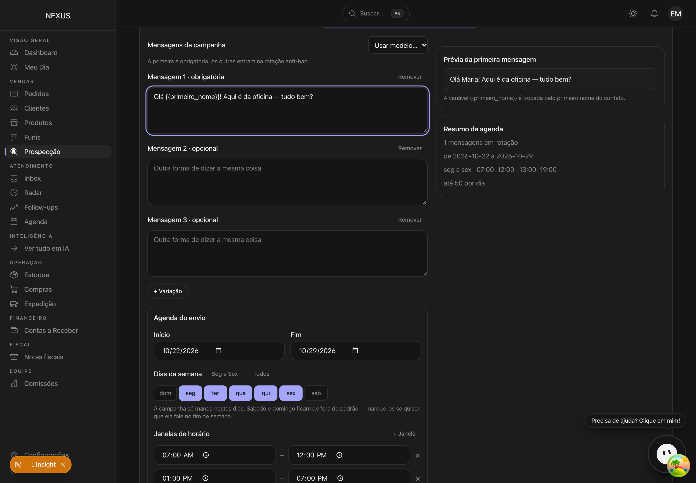
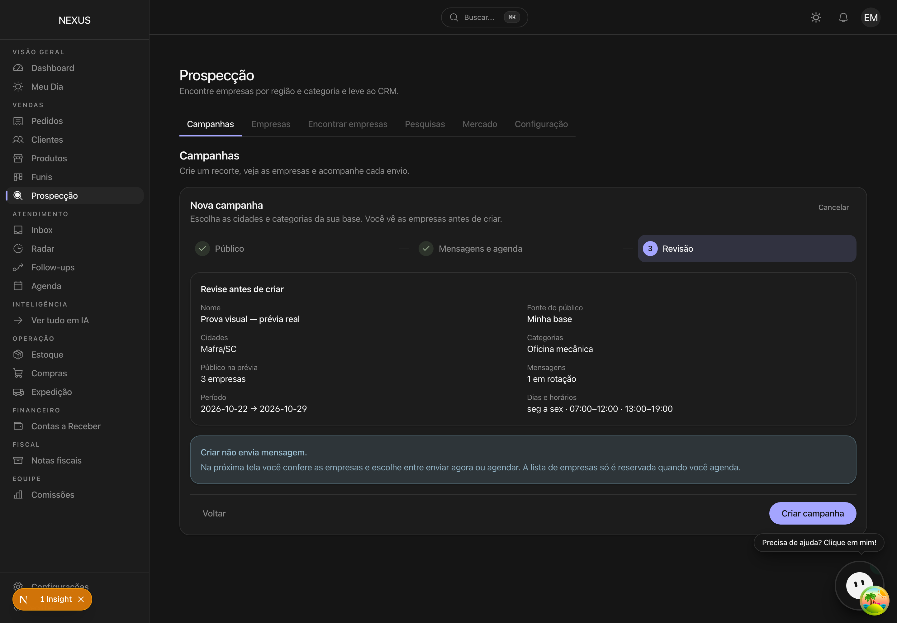
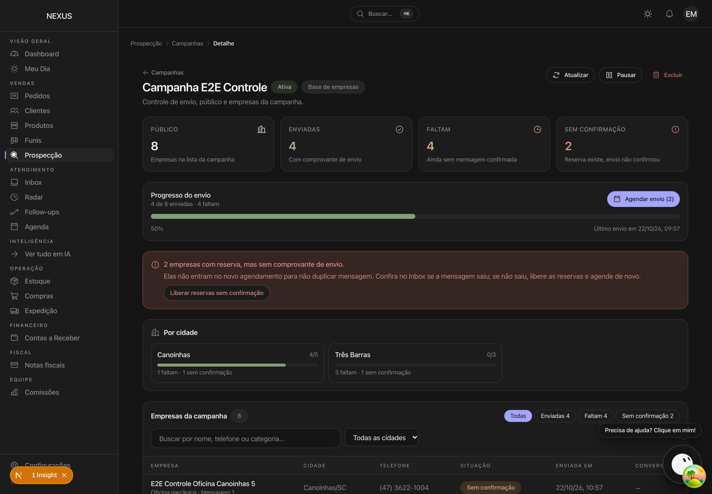

# Prova visual — assistente e controle da campanha

Capturado contra o Supabase local semeado, com o app rodando (`E2E_PORT=3020`),
login pela tela como `manager`. O capturador é
`tests/capture-controle-campanha.ts` e falha alto em erro de console — esta
execução terminou com zero.

Cada imagem existe para sustentar uma afirmação que um teste unitário não
alcança (a tela que o operador vê):

## 1. A lista abre em Campanhas, com o envio no card

`01-lista-de-campanhas.png` — `4 de 8 enviadas · 4 faltam · 2 sem confirmação`,
barra de progresso e o botão **Controlar**.

## 2. A cidade é escolhida da base, com contagem

`02-assistente-previa.png` — Mafra 3, Canoinhas 5, Três Barras 3; a prévia
devolve as **3 empresas reais** de Mafra, com telefone, antes de criar.

## 3. Mensagens e agenda

`03-assistente-mensagens.png` — a mensagem digitada, o modelo opcional e as
janelas de horário herdadas da campanha.

## 4. Revisão

`04-assistente-revisao.png` — `Público na prévia: 3 empresas`, e o aviso de que
criar não envia nada.

## 5. O controle da campanha

`05-controle-da-campanha.png` — Público 8 · Enviadas 4 · Faltam 4 · **Sem
confirmação 2**, quebra por cidade, filtros e a liberação manual das reservas
sem comprovante.

## Um achado que a captura revelou

A primeira tentativa usou **Canoinhas** e a prévia respondeu `0 empresas`: as
cinco de lá já estavam reservadas por outra campanha. A tela não deixou
avançar e disse o motivo — o filtro `idsReservadosPorOutras` funciona de ponta
a ponta. Por isso as capturas usam **Mafra**, cujas empresas estavam livres.
