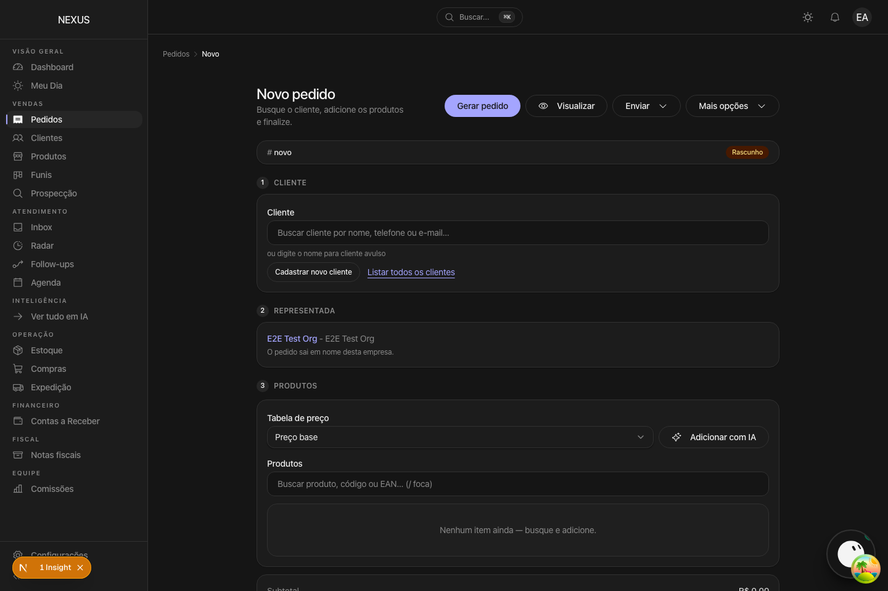
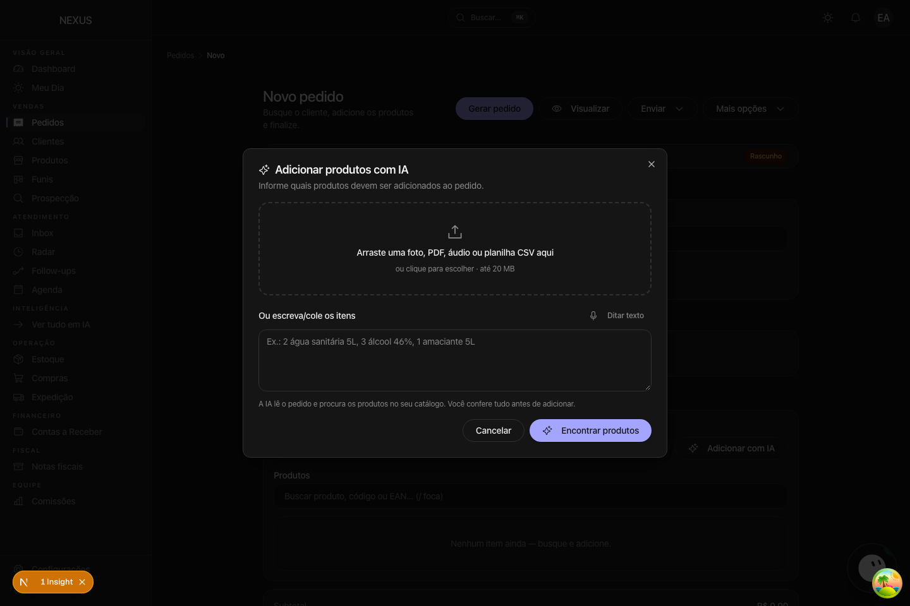
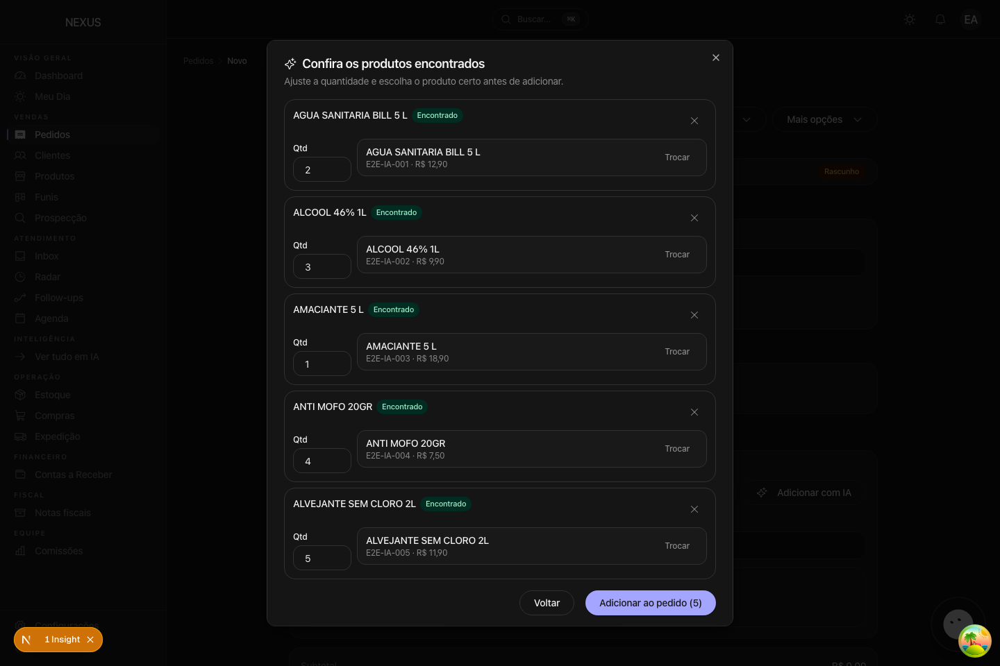
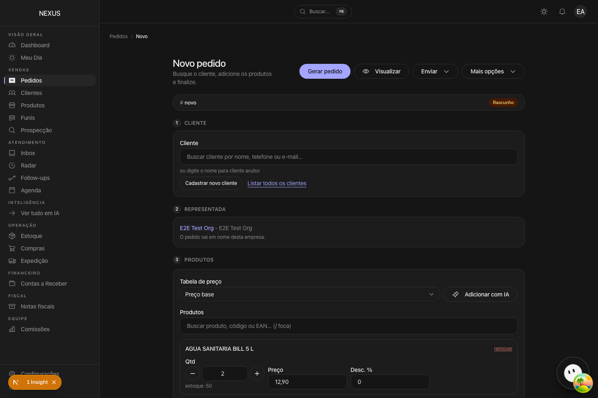

# Pedido por IA — prova visual

Capturas do fluxo de **Adicionar com IA** no editor de pedido, feitas em
2026-10-23 contra o dev server local com um provider OpenAI-compatible de
teste. O modelo devolveu os cinco itens do pedido manuscrito; o casamento com
o catálogo e a conferência são o código real da rota.

1. O botão fica na seção de produtos, ao lado da tabela de preço:

   

2. A entrada aceita foto, PDF, áudio, CSV/TXT, texto colado e ditado; o limite
   é 20 MB:

   

3. A revisão mostra a descrição lida, a quantidade editável, o selo de
   confiança e até três candidatos do catálogo por item:

   

4. Só depois do clique em **Adicionar ao pedido** os itens entram no rascunho,
   com as quantidades do pedido:

   
